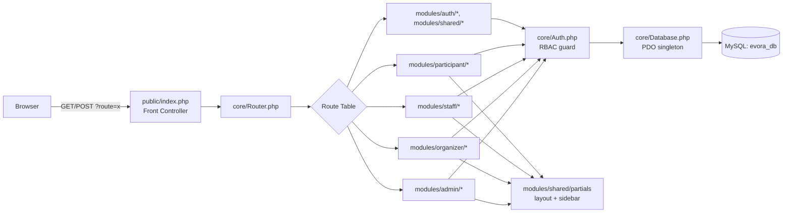

# EVORA System Architecture

## Overview
EVORA is a server-rendered PHP 8 web application (no framework) using PDO/MySQL, organized by role-based
modules. It runs on a standard XAMPP stack (Apache + MySQL/MariaDB + PHP).

## Request Flow

## Core Services (`/core`)

| Class | Responsibility |
|---|---|
| `Database` | PDO singleton, prepared statements only |
| `Auth` | Session lifecycle, login/logout, `requireRole()` guard, idle timeout |
| `Csrf` | Per-session CSRF token issue + verification |
| `Upload` | MIME + extension + size validated file uploads, random filenames |
| `QrService` | HMAC-signed QR token generation/verification, PNG rendering via `endroid/qr-code` |
| `Logger` | Writes to `activity_logs` for audit trail |
| `ReportQueries` | Builds `{columns, rows}` tabular data shared by on-screen, PDF, and Excel reports |
| `ReportExporter` | Renders report data to PDF (`dompdf/dompdf`) or Excel (`phpoffice/phpspreadsheet`) |
| `EventStatusService` | Single point of change for event lifecycle status; writes `event_status_logs` on every transition |
| `CertificateService` | Issues certificate PDFs (with certificate number + verification QR) — called manually by organizers or automatically on attendance confirmation for Seminar/Workshop events |

## Layered Responsibilities

1. **Presentation** — `modules/shared/partials/*` (layout, sidebar, topbar) rendered per role.
2. **Route handlers** — one PHP file per route in `modules/{role}/*`; each file re-validates the caller's
   role via `Auth::requireRole()` even though the router already dispatched it there, and re-checks
   resource ownership (e.g. an organizer can only manage their own events) directly in SQL `WHERE` clauses.
3. **Data access** — always through `Database::connection()` with parameterized queries.
4. **File storage** — `storage/uploads/{ids,docs,payments,banners,items,qr,certificates}`, never web-linked
   directly; served through `public/uploads_guard.php` which re-derives ownership from the DB before
   streaming the file.

## Security Model

- **Auth**: bcrypt password hashing (`password_hash`/`password_verify`), session regenerate-on-login,
  idle timeout (`SESSION_TIMEOUT`), logout clears session + cookie.
- **CSRF**: every state-changing form carries a session-bound token verified server-side; AJAX endpoints
  (QR scan/claim) verify the same token from the POST body.
- **RBAC**: four roles (admin/organizer/staff/participant); staff is additionally scoped to specific events
  via `event_staff` + granular `staff_permissions`.
- **QR integrity**: tokens are `{registrationId}.{HMAC-SHA256(registrationId, QR_SECRET)}` — a scanner
  cannot forge a valid token without the server secret, and incrementing IDs won't produce valid signatures.
- **File uploads**: extension whitelist + real MIME sniffing (`finfo`) + size cap + random filename on disk.
