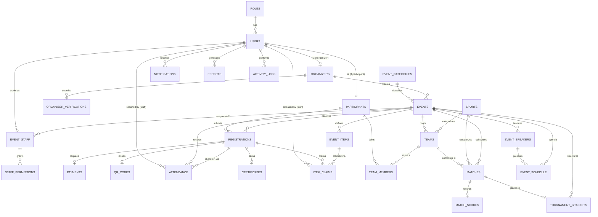
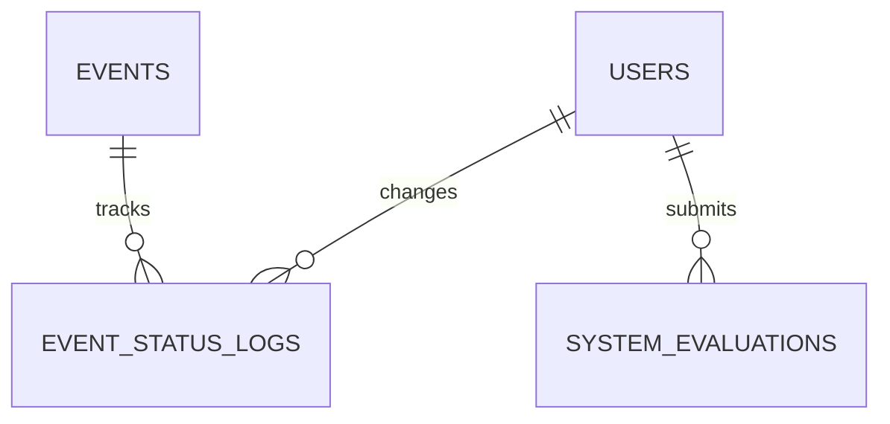

# EVORA Entity-Relationship Diagram

Full DDL lives in `database/schema.sql`. This is the logical ERD.

## Enhancement Pass Additions

- `events` gained `admin_remarks`, `registration_deadline`, and an extended `status` enum:
  `draft → pending_approval → approved → open → closed → ongoing → completed → archived`
  (plus `cancelled`/`removed` for moderation). `event_status_logs` audits every transition.
- `users` gained `profile_picture_path` (shown on the staff QR-scan participant card).
- `certificates` gained `certificate_number` and `verification_token` (scanned from a QR printed on
  the certificate itself, resolved by the public `certificate-verify` route).
- `system_evaluations` — one row per ISO/IEC 25010 submission (8 category scores 1–5 + comment).

## Key Constraints

- `registrations`: `UNIQUE(event_id, participant_id)` — one registration per participant per event.
- `attendance`: `UNIQUE(registration_id, event_id)` — prevents duplicate check-in.
- `item_claims`: `UNIQUE(event_item_id, registration_id)` — prevents duplicate item claim.
- `event_staff`: `UNIQUE(event_id, user_id)` — a staff account is assigned to an event at most once.
- `qr_codes.registration_id`: `UNIQUE` — one QR per registration, generated only after approval
  (+ payment approval for paid events).
