# EVORA Use Case Overview

```mermaid
flowchart TB
    subgraph Admin
        UC1[Review & approve/reject/suspend organizers]
        UC2[Monitor & remove events]
        UC3[Manage user accounts]
        UC4[Generate platform reports]
        UC5[View activity logs]
    end
    subgraph Organizer
        UC6[Apply for verification]
        UC7[Create & manage events]
        UC8[Assign staff & permissions]
        UC9[Approve/reject registrations]
        UC10[Approve/reject payments]
        UC11[Manage teams/matches/bracket]
        UC12[Manage speakers/schedule/certificates]
        UC13[Generate event reports]
    end
    subgraph Staff
        UC14[Scan participant QR]
        UC15[Record attendance]
        UC16[Release event items]
    end
    subgraph Participant
        UC17[Browse events]
        UC18[Register for event]
        UC19[Upload payment proof]
        UC20[View/download QR code]
        UC21[View registrations & certificates]
    end

    Admin_Actor((Administrator)) --> UC1 & UC2 & UC3 & UC4 & UC5
    Organizer_Actor((Organizer)) --> UC6 & UC7 & UC8 & UC9 & UC10 & UC11 & UC12 & UC13
    Staff_Actor((Staff)) --> UC14 & UC15 & UC16
    Participant_Actor((Participant)) --> UC17 & UC18 & UC19 & UC20 & UC21
```

## Actor Summary

| Actor | Can | Cannot |
|---|---|---|
| Administrator | Approve organizers, monitor/remove events, manage user accounts, view platform-wide reports/logs | Manage day-to-day operations of a specific event |
| Organizer | Everything under one or more of their own **approved** events | Access another organizer's events, approve their own verification |
| Staff | Only the specific permissions (`scan_qr`, `verify_participant`, `record_attendance`, `manage_claims`, `view_announcements`) granted for the event(s) they're assigned to | Create events, manage other organizers, access unassigned events, change system settings |
| Participant | Browse events, register, pay, receive QR, view own certificates | Access any organizer/admin/staff functionality |
