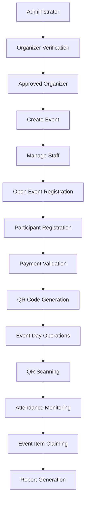
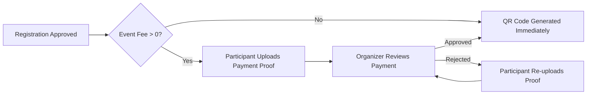

# EVORA End-to-End User Flow

This is the lifecycle the system was built to implement, per the project brief.

## Branch: Free vs Paid Events

## Branch: QR Validation Rules (enforced in `modules/staff/scan_verify.php`)

On every scan, in order:
1. Token signature valid (HMAC matches `QR_SECRET`) — else **INVALID**.
2. Scanning staff has the `scan_qr` permission for the selected event — else **INVALID**.
3. Registration exists — else **INVALID**.
4. Registration's event matches the event being scanned — else **INVALID**.
5. Registration status is `approved` — else **INVALID**.
6. If event fee > 0, payment status is `approved` — else **INVALID**.
7. Not already checked in for this event (`attendance` unique constraint) — else **INVALID**.
8. All pass → attendance recorded → **VALID**.

Item claiming (`modules/staff/claim_action.php`) runs the same identity checks (1–6) plus stock and
duplicate-claim checks before releasing an item.
